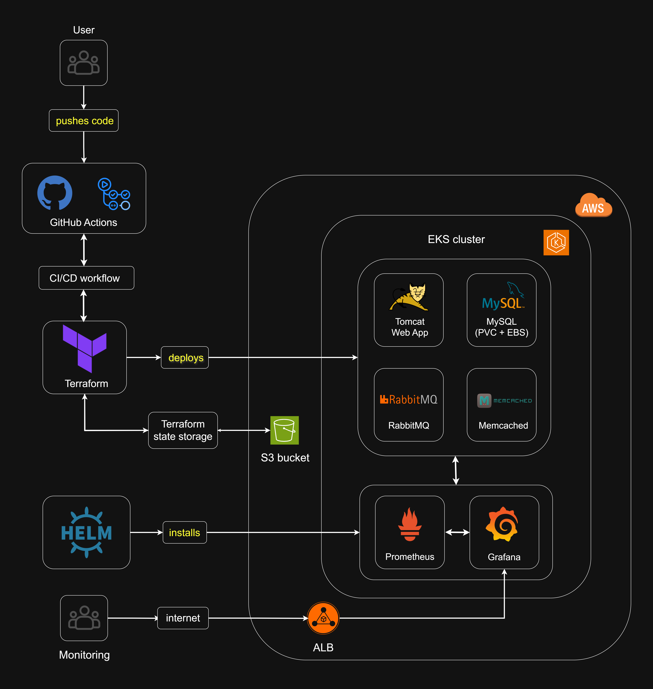

# Project 3: EKS Infrastructure Deployment with Terraform, GitHub Actions CI/CD, and Observability  

[](#)
[](#)
[](#)
[](#)


---

## About the 3-Project DevOps System

This self-designed, 3-part DevOps portfolio series is intended to demonstrate the staged cloud migration and infrastructure maturity path of a multi-service web application: from containerization, to Kubernetes orchestration, to infrastructure automation, CI/CD, and observability.

- **Project 1**: Multi-service containerization and deployment using Docker Compose on AWS EC2 - [Project 1](https://github.com/ravi-rajyaguru15/Project-01-dockerized-multi-service-application)
- **Project 2**: Kubernetes orchestration of the same application stack on AWS EKS - [Project 2](https://github.com/ravi-rajyaguru15/Project-02-eks-k8s-infrastructure-orchestration)
- **Project 3 (this)**: Infrastructure as Code with Terraform, CI/CD via GitHub Actions, and monitoring using Prometheus and Grafana

The Java web application used across this portfolio is externally sourced. Minor UI/content adjustments are made to remove source-specific branding and present it as a neutral demo web application. The infrastructure design, containerization, cloud deployment, Kubernetes manifests, Terraform configuration, CI/CD workflow setup, monitoring integration, documentation, troubleshooting, and migration-stage decisions were independently implemented. The same application stack is intentionally reused across all three projects so the focus remains on infrastructure maturity and core DevOps practices.

---

## Project Overview

This project demonstrates the third migration stage: adding infrastructure automation, CI/CD-driven deployment, and observability around the EKS-based application stack from Project 2.

The AWS infrastructure is provisioned using Terraform, including VPC networking, public/private subnets, NAT gateway, IAM configuration, EKS managed node groups, EBS CSI support, and S3-backed Terraform state. Kubernetes manifests are used to deploy the application stack into EKS, while GitHub Actions automates Terraform plan/apply, Kubernetes deployment, and basic post-deployment verification steps.

Prometheus and Grafana are deployed with Helm to provide Kubernetes workload and infrastructure visibility through dashboards and metrics. This project brings together infrastructure provisioning, deployment automation, Kubernetes runtime configuration, persistent storage, and observability into one production-inspired cloud/DevOps workflow.

---

## Project Scope

This stage focuses on Terraform-based AWS infrastructure provisioning, CI/CD workflow automation with GitHub Actions, Kubernetes deployment workflows, S3-backed Terraform state, EBS CSI integration, and Prometheus/Grafana-based observability.

It is not intended to represent a fully production-operated cloud platform. Advanced security hardening, multi-environment promotion, GitOps, centralized logging, incident response, cost governance, state locking, OIDC-based CI/CD authentication, and team-based operating models are intentionally outside the scope of this stage and are areas I aim to deepen through professional cloud/platform engineering experience.

---

## Architecture Overview



---

## Tech Stack

- **Infrastructure**: AWS EKS, EKS managed node groups, VPC networking, public/private subnets, NAT gateway
- **Infrastructure as Code**: Terraform, S3-backed Terraform state
- **Orchestration**: Kubernetes
- **Workloads**: Tomcat web app, MySQL, RabbitMQ, Memcached
- **Routing**: NGINX Ingress Controller, Kubernetes Ingress, AWS load balancing
- **Storage**: PersistentVolumeClaim, Amazon EBS, EBS CSI Driver
- **Runtime Configuration & Startup Control**: Kubernetes Secrets, initContainers
- **CI/CD & Automation**: GitHub Actions
- **Monitoring & Observability**: Prometheus, Grafana, Helm
- **Tooling**: `kubectl`, AWS CLI, Docker Hub

---

## Repository Structure

```text
Project_03/
│
├── .github/                                       # GitHub Actions CI/CD pipeline
│   └── workflows/                                
│       └── deploy.yml
│
├── terraform/                                     # Modular Terraform setup for AWS EKS
│   ├── aws-ebs-csi.tf                             # EBS CSI driver IAM role and EKS add-on configuration
│   ├── eks-cluster.tf                             # EKS cluster and managed node group configuration
│   ├── main.tf                                    # AWS provider, data sources, and local values
│   ├── outputs.tf                                 # Terraform outputs such as cluster endpoint
│   ├── terraform.tf                               # Provider requirements and S3 backend configuration
│   ├── variables.tf                               # Variables for AWS region and cluster name
│   └── vpc.tf                                     # VPC, public/private subnets, NAT gateway and subnet tags
│            
├── kubernetes/
│   ├── deployments/                               # Pods for app, mysql, rabbitmq, memcached 
│   │   ├── app-deployment.yaml                      and initContainers
│   │   ├── mysql-deployment.yaml
│   │   ├── rabbitmq-deployment.yaml
│   │   └── memcached-deployment.yaml
│   │
│   ├── services/                                  # ClusterIP services      
│   │   ├── web-app-service.yaml
│   │   ├── mysql-service.yaml
│   │   ├── rabbitmq-service.yaml
│   │   └── memcached-service.yaml
│   │
│   ├── ingress/                                   # NGINX ingress resource
│   │   └── nginx-ingress.yaml
│   │
│   ├── secrets/                                   # Base64 encoded secrets containing MySQL 
│   │   └── secrets.yaml                             and RabbitMQ credentials
│   │
│   └── persistentVolumeClaim/                     # MySQL PVC
│       └── mysql-pvc.yaml
│      
├── images/
|   ├── screenshots/...                            # Screenshots of k8s pods & services, terraform apply & plan, CI/CD pipeline, Grafana monitoring, etc.
│   └── architecture/
|         └── project-3-architecture.png           # Architecture overview diagram of Project 3
│      
├── legacy/                                        # Files and artifacts carried over from project 1 and 2  
│   ├── app/...                                      for continuity purposes, but are not an active  
│   ├── mysql/...                                    part of project 3.
│   ├── nginx/...
│   ├── images/...                         
│   ├── .env                                                                           
│   ├── docker-compose.yaml
│   └── project2-eksctl-config.yaml 
│ 
├── .gitignore                                     # gitignore file to prevent large runtime generated files from pushing into repository.                     
│                     
└── README.md                                      # Project README
```
---

## How to Deploy (Reproduction Steps)

1. **Prerequisites/Dependencies**:
      - Local machine with `aws-cli`, `kubectl`, `terraform`, `helm`, and `git` installed.
      - AWS account configured via AWS CLI, and with appropriate IAM permissions.
      - GitHub repository configured with the required GitHub Actions secrets: `AWS_ACCESS_KEY_ID`, `AWS_SECRET_ACCESS_KEY`, and `AWS_REGION`.  
      - A remote S3 bucket created manually beforehand for Terraform backend state, with the bucket name matching the backend configuration in `terraform/terraform.tf`.

2. Open a Bash terminal, clone the repository, and navigate into the project folder.

3. Provision the EKS infrastructure via Terraform: 

    ```bash
    cd terraform
    terraform init
    terraform plan
    terraform apply     # Approve this request with "yes" when Terraform prompt occurs
    ```
4. Connect to the EKS cluster and verify node access: 

    ```bash
    cd ..
    aws eks update-kubeconfig --region us-east-1 --name project3-eks-cluster
    ```
    ```bash
    kubectl get nodes
    ```
5. Install the NGINX Ingress Controller and verify its pods and services:

    ```bash
    kubectl apply -f https://raw.githubusercontent.com/kubernetes/ingress-nginx/controller-v1.10.1/deploy/static/provider/aws/deploy.yaml
    ```
    ```bash
    kubectl get pods -n ingress-nginx
    kubectl get svc -n ingress-nginx
    ```
6. Apply the Kubernetes manifests:

    ```bash
    kubectl apply -f kubernetes/secrets/
    kubectl apply -f kubernetes/persistentVolumeClaim/
    kubectl apply -f kubernetes/deployments/
    kubectl apply -f kubernetes/services/
    kubectl apply -f kubernetes/ingress/
    ```
7. Verify the application deployment:

    ```bash
   kubectl get pods
   kubectl get pvc
   kubectl get svc
   kubectl get ingress
    ```
    ```bash
   kubectl get all     # Alternatively, this command can also be used to verify deployments.
    ```
8. Access the web application using the external DNS endpoint from the NGINX Ingress Controller: 

    ```bash
    # Locate EXTERNAL-IP of ingress-nginx service
    
    kubectl get svc -n ingress-nginx
    ```
9. Trigger the GitHub Actions workflow by pushing changes to the repository:
     
     ```bash
     git add .
     git commit -m "Update infrastructure or Kubernetes deployment"
     git push origin main

     # The GitHub Actions workflow runs Terraform init/plan/apply, updates kubeconfig, applies Kubernetes manifests, and performs basic deployment verification.
     ```
10. Install Prometheus and Grafana with Helm:
     
     ```bash
     # Add Helm chart repositories
    
     helm repo add prometheus-community https://prometheus-community.github.io/helm-charts
     helm repo add grafana https://grafana.github.io/helm-charts
     helm repo update
     ```
     ```bash
     # Create monitoring namespace
     
     kubectl create namespace monitoring
     ```
     ```bash
     # Install Prometheus
     
     helm install prometheus prometheus-community/prometheus \
     --namespace monitoring \
     --create-namespace \
     --set server.persistentVolume.enabled=false
     ```
     ```bash
     # Install Grafana
     
     helm install grafana grafana/grafana --namespace monitoring
     ```
11. Access Grafana using port forwarding:     

     ```bash
     # Retrieve Grafana admin password
     
     kubectl get secret --namespace monitoring grafana -o jsonpath="{.data.admin-password}" | base64 --decode ; echo
     ```
     ```bash
     # Forward Grafana service to localhost
     
     kubectl port-forward --namespace monitoring svc/grafana 3000:80
     ```
     ```text
     Open `http://localhost:3000` and log in with:

     Username: admin
     Password: <decoded-password>
     ```

12. Add Prometheus as a data source:
    
     Inside Grafana, add Prometheus as data source and set URL to `http://prometheus-server.monitoring.svc.cluster.local`

13. Import Kubernetes monitoring dashboards into Grafana. Example dashboard IDs:
     
     | Dashboard                                         | Grafana.com ID   | 
     |---------------------------------------------------|------------------|
     | Kubernetes cluster monitoring (via Prometheus)    |       315        |
     | Node Exporter Full (node-level metrics)           |       1860       | 
     | Prometheus 2.0 Overview                           |       3662       | 
   
           
            
14. After verification, destroy the infrastructure to avoid unnecessary AWS costs:
    
    ```bash
     cd terraform
     
     terraform destroy -target=module.eks -auto-approve
     terraform destroy -auto-approve
     ```
    ```text
    Notes on terraform destroy:

    If Terraform destroy gets stuck because AWS is still retaining dependent resources such as ENIs, NAT gateway resources, or Elastic IPs, remove the blocking resources from the AWS Console or AWS CLI and rerun terraform destroy.
    ```
---

## Engineering Insights

- Built Terraform-managed AWS infrastructure for the EKS platform, including VPC networking, public/private subnets, NAT gateway, IAM configuration, EKS managed node groups, and EBS CSI support.
- Configured S3-backed Terraform state to separate infrastructure state from local development files and support repeatable Terraform workflows.
- Built a GitHub Actions workflow with multiple deployment stages, including Terraform init/plan/apply, kubeconfig update, Kubernetes manifest apply, and basic deployment verification.
- Reused and adapted Kubernetes manifests from Project 2 to deploy the same application stack into the Terraform-provisioned EKS environment.
- Configured EBS CSI support through Terraform to enable PVC-backed persistent storage for MySQL.
- Deployed Prometheus and Grafana using Helm to monitor Kubernetes workloads and infrastructure behavior through imported dashboards.
- Debugged infrastructure and deployment issues including EBS CSI IAM configuration, PVC binding behavior, initContainer failures, CrashLoopBackOff events, image rebuild issues, and Prometheus storage behavior.
- Rebuilt, tagged, and republished custom Docker Hub images when application or database image changes needed to be reflected in the EKS deployment.

---

## Natural Extension Points

This project intentionally focuses on Terraform-based EKS infrastructure provisioning, CI/CD-driven deployment, and basic Kubernetes observability. Given more time and a production-oriented team context, natural next iterations could include:

- **Terraform backend bootstrap and state locking**: Automating creation of the remote state backend and adding a locking mechanism, such as DynamoDB-based locking or an equivalent backend-supported approach.
- **CI/CD authentication hardening**: Replacing long-lived AWS access keys in GitHub Actions with OIDC-based role assumption.
- **Observability automation**: Moving Prometheus/Grafana installation, dashboard configuration, and monitoring setup into a repeatable Terraform, Helm, or pipeline-managed workflow.
- **GitOps-based deployment model**: Introducing a GitOps controller such as Argo CD to separate infrastructure provisioning from continuous application reconciliation.
- **Multi-environment workflow**: Extending the project toward separate dev/staging/prod-style environments with clearer promotion, approval, and rollback patterns.

These are not included in the current implementation because the scope of this portfolio stage is to demonstrate the core platform-building blocks: infrastructure as code, Kubernetes deployment automation, persistent storage integration, CI/CD, and observability fundamentals.